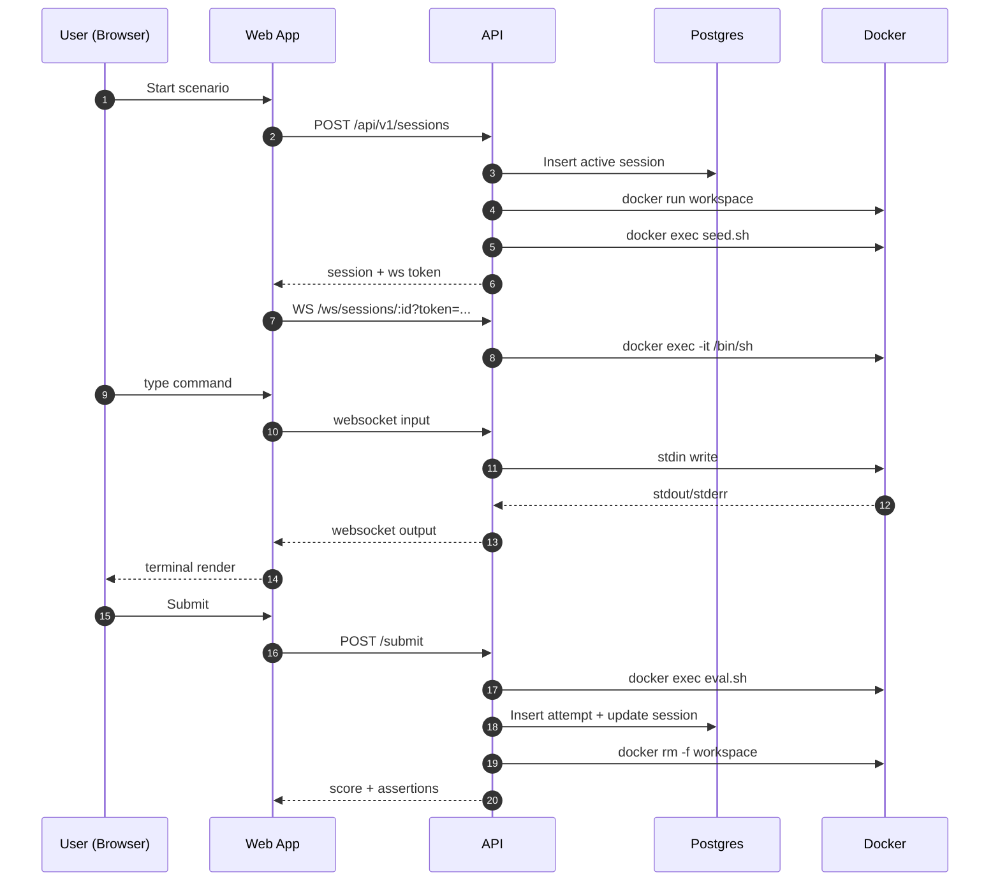

# 03 - Architecture and Flow

This doc explains runtime behavior from user click to score.

## Runtime Components

- Web SPA (`apps/web`) served by nginx.
- API service (`apps/api`) using Fastify + websocket plugin.
- Postgres for scenarios, sessions, attempts.
- Docker daemon used by API to create one workspace container per active session.
- Scenario shell scripts (`seed.sh`, `eval.sh`) loaded from disk.

## High-Level Request Paths

1. Catalog and history
- Web calls API REST endpoints under `/api/v1/*`.
- API reads/writes Postgres through `Repository`.

2. Session start
- Web `POST /api/v1/sessions`.
- API creates session row and calls `WorkspaceManager.ensureWorkspace`.
- Workspace manager launches `docker run ...` container.
- Scenario seed script runs inside container to create challenge repo.

3. Terminal interaction
- Web opens `WS /ws/sessions/:id?token=<wsToken>`.
- API validates session ownership/status/token.
- API spawns PTY bridge process attached to `docker exec -it`.
- Bytes pass both ways between browser xterm and container shell.

4. Submit and scoring
- Web `POST /api/v1/sessions/:id/submit`.
- API runs scenario `eval.sh` in container.
- Evaluator emits `ASSERT:*` lines.
- API parses assertions, computes score, stores attempt, marks session evaluated.
- API stops workspace container.

## Sequence Diagram

## Session Lifecycle

`sessions.status` transitions:

- `active` -> `evaluated` (successful submission pipeline)
- `active` -> `terminated` (manual quit or timeout cleanup)
- `submitted` is reserved in schema and accepted as "workspace-live" in API checks

Expiration behavior:

- `expires_at` is set on creation (`started_at + 30m`).
- Expired `active/submitted` sessions are terminated by repository methods before reads/writes.
- A partial unique index enforces only one `active/submitted` session per user.

## Auth Status (Current)

Auth now uses `/api/v1/auth/google` + server-managed session cookies.

- Web obtains a Google ID token using Google Identity Services and calls `POST /api/v1/auth/google`.
- API validates the Google ID token against `GOOGLE_CLIENT_ID`, then upserts the user record.
- API issues an HTTP-only cookie tied to `auth_sessions` in Postgres.
- API returns a per-session CSRF token; mutating authenticated routes require `x-gitarena-csrf`.
- Protected session/attempt/history routes enforce request-scoped `user.id`.
